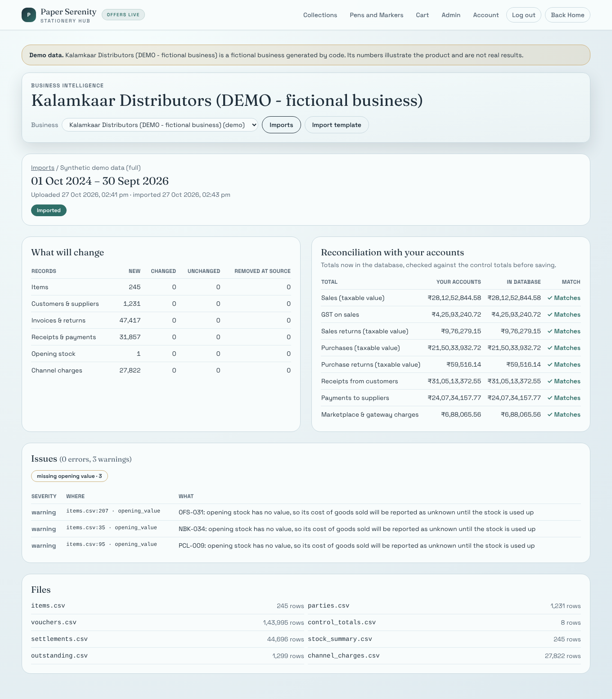
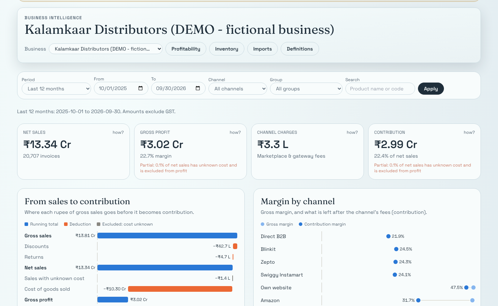
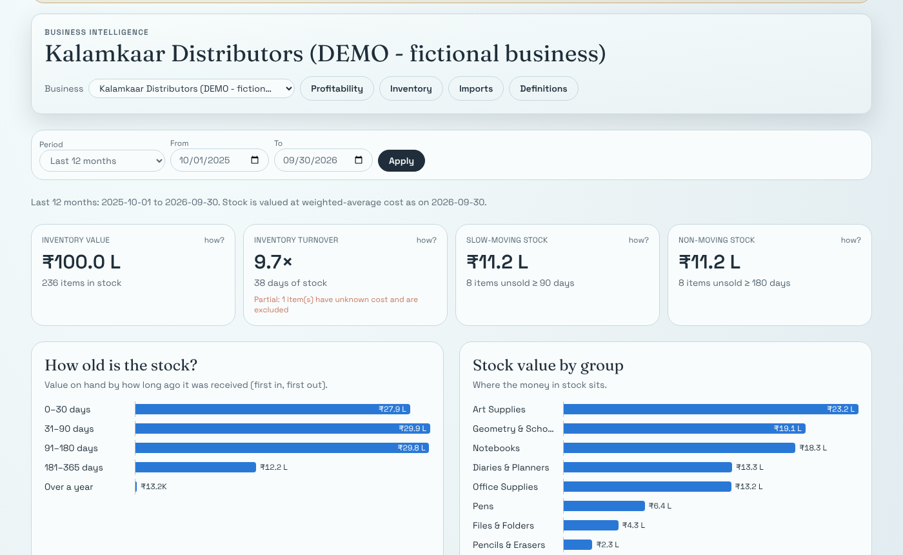
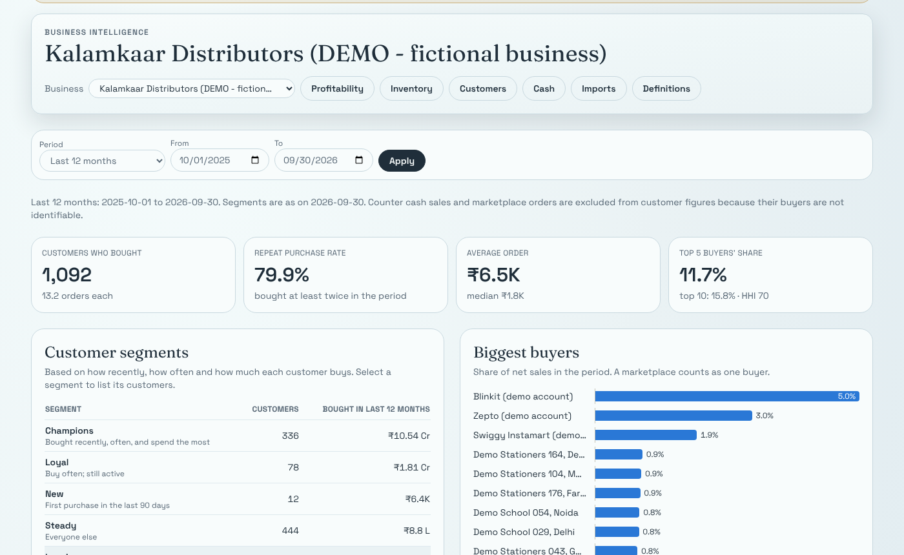
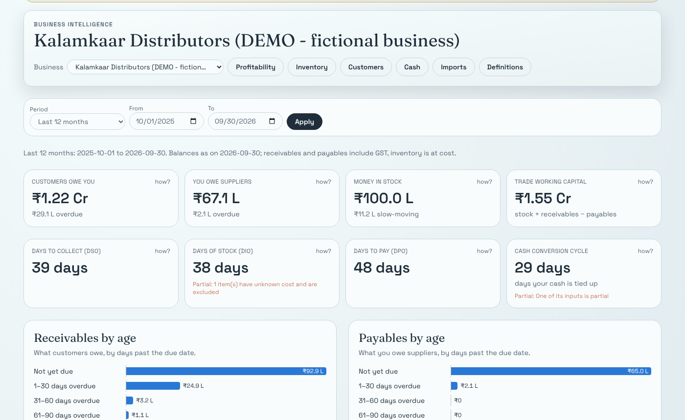

# Milestone Log

## M0 — Audit and plan (2026-10-27)
Planning docs 00–08 in this folder. No production code changed.

## M1 — Foundation (2026-10-27)

**Implemented**
* Canonical, tenant-scoped ledger: 16 tables + 9 enums (`Tenant`, `Membership`, `DataSource`, `ImportBatch`, `ImportIssue`, `SourceRecord`, `Party`, `ItemGroup`, `Item`, `Batch`, `Voucher`, `VoucherLine`, `StockMovement`, `StockSnapshot`, `OutstandingSnapshot`, `AuditLog`). Money `Decimal(18,2)`, quantities `Decimal(18,3)`. Batch/expiry fields included now, so the pharmacy pack (M12) needs no migration.
* **Cross-tenant links blocked by the database:** 19 composite `(id, tenantId)` foreign keys. Optional links use `Restrict`/`Cascade` (never `SetNull`, which would null `tenantId`).
* `forTenant(tenantId)`: a Prisma client extension that adds the tenant predicate to every read, update and delete, stamps `tenantId` on creates, and refuses writes addressed to another tenant.
* Session fixes (debt items 1–3): tokens expire after 7 days (matching the cookie), there is no fallback secret in production, and signatures are compared in constant time. Existing call sites are unchanged.
* `DomainPack` contract with an active `stationery` pack and a `planned` `pharmacy` pack (attribute schemas via Zod, thresholds, seasonality, campaign policy that blocks prescription-drug promotion, batch tracking, tax-inclusive pricing).
* Integration test harness against real PostgreSQL (`npm run test:int`, `TEST_DATABASE_URL`); CI runs it with a Postgres 16 service.

**Files**
* `prisma/schema.prisma` (storefront models untouched except a `memberships` back-relation on `User`)
* `prisma/migrations/20261027064801_canonical_ledger/`
* `src/lib/auth.ts`, `src/lib/auth.test.ts`
* `src/server/db/tenant.ts`, `tenant.test.ts`, `tenant.int.test.ts`
* `src/domain/types.ts`, `src/domain/packs/{index,stationery,pharmacy}.ts`, `packs.test.ts`
* `vitest.config.ts`, `vitest.integration.config.ts`, `scripts/test-db-setup.mjs`, `.github/workflows/ci.yml`, `package.json`, `.env.example`

**Why this design**
* Composite foreign keys make isolation a database guarantee, not just a convention. Even an unscoped query or a nested `include` cannot join across tenants.
* The extension is a single choke point that is easy to audit. A unit test fails if any model with a `tenantId` column is missing from the scoped list.
* Packs are plain typed modules, not database configuration: reviewable, testable, and versioned with the code.

**Tests (actual results, this container, PostgreSQL 16)**
```
npm run lint        0 errors, 1 pre-existing warning (admin/inventory )
npx tsc --noEmit    no errors
npm test            4 files, 25 tests passed
npm run test:int    1 file, 9 tests passed
npm run build       compiled successfully
prisma migrate diff (migrations vs schema)   no difference
```
Migration is additive only: no `DROP`, and no `ALTER` on storefront tables.

**Known limitations**
* Raw SQL (`$queryRaw`) is not scoped by the extension. Analytics SQL must take `tenantId` explicitly; Postgres RLS is planned for M11.
* No UI or API uses the new tables yet; tenant selection in the session comes with the import UI (M3).
* The metric-registry skeleton planned for M1 has moved to M5, where the first metrics exist; an empty registry would be speculative.
* Pharmacy regulatory rules are encoded from general knowledge and need legal review (see `08-domain-packs.md`).

**Next: M2 — synthetic data generator** (seeded, deterministic, stationery profile, planted problems, accounting invariants asserted by tests).

## M2 — Synthetic data generator (2026-10-27)

**Implemented**
* Deterministic generator (`src/server/demo/`): seeded PRNG with independent sub-streams; a trade-agnostic engine; a stationery profile for the fictional *Kalamkaar Distributors (DEMO)*. 2 years (Oct 2024–Sep 2026), 245 items, 1,229 parties, ~41k sales invoices across **6 channels**: direct B2B, counter, own website, Amazon, Meesho, Blinkit.
* Output is the **import template** (`src/server/ingest/template.ts`): items, parties, vouchers (day-book lines), settlements (bill-wise), stock summary, bills outstanding, channel charges, control totals. Plus `ground_truth.json` with planted problems and the totals analytics must reproduce. Demo data will enter the database through the same importer as real data (M3).
* Accounting rules: integer paise; weighted-average cost; demand capped by stock (lost demand recorded); credit notes reduce their invoice; receipts/payments allocated bill-wise; marketplace payouts net of fees with TCS per order and TDS per settlement period.
* Planted problems:
  * 8 bulk-bought slow movers (₹11.3 L stuck at period end);
  * 2 lapsing key retailers;
  * 8 schools that didn't reorder for the new school year;
  * a 14% cost rise plus extra discounting on Pens (margin erosion);
  * 25 slow payers (+30–75 days);
  * 2 chronic stockout SKUs;
  * 3 items with missing opening cost;
  * emergent marketplace loss-makers (Meesho: 48% gross margin → 1.3% contribution after shipping).
* `npm run demo:generate -- --seed 42 --out <dir>` writes the files (~4 s, ~21 MB). Output is git-ignored because it is reproducible.

**Why this design**
* Generating *template files* rather than writing to the database means the demo exercises the real ingestion path. It also gives users a worked example of the template.
* The tests are black-box: they parse the emitted rows and independently rebuild stock, WAC valuation, bills and contribution, then check the generator's ground truth against that rebuild. This caught a real bug during development: two product groups produced the same item codes (`PEN-001` for both Pens and Pencils). The engine now refuses duplicate codes.

**Tests (actual results, this container)**
```
npm test            5 files, 51 tests passed   (generator suite: 26 tests, ~24 s)
npm run test:int    1 file, 9 tests passed
npm run lint / tsc / build   clean (1 pre-existing lint warning)
```
Covered:
* determinism (same seed → identical hash);
* no realistic contact data;
* referential integrity and posting order;
* line arithmetic on every row;
* stock never negative and equal to the stock summary;
* independent WAC replay equal to the reported closing value;
* returns within quantities sold;
* bills never over-settled and outstanding exact;
* control totals;
* channel-charge integrity;
* ground truth = independent rebuild (FY net sales/COGS, contribution per channel × item);
* each planted problem visible in the data.

**Known limitations**
* Fee amounts, GST rates per group, HSN codes, payout timings, return rates and Blinkit's buy price/terms are **illustrative**, labelled as such in the profile and dataset notice.
* Simplifications: single warehouse (no FBA stock); no B2C refunds on the own website or counter; no Blinkit fill-rate debit notes; Amazon referral fee omitted (0% under ₹1,000 for stationery).
* The generator suite takes ~24 s (three full generations plus row-level checks). Acceptable for now; it can share one generated dataset across files later.

**Next: M3 — import pipeline** (template parsing with Zod, staging, validation report, idempotent commit, file-hash dedup, corrections, reconciliation to control totals, `ChannelCharge` table).

## M3 — Import pipeline (2026-10-27)



**Implemented**
* **Parser** (`src/server/ingest/parse.ts`): CSV via `csv-parse`.
  * Handles BOM, CRLF, quoted commas and the formula guard.
  * Amounts and quantities become exact decimals.
  * Every problem becomes an issue with `file:line` and field; the parser never throws on bad data.
  * Limits: 50 MB per file, 1 M rows per file.
* **Validation** (`validate.ts`):
  * line arithmetic to the paisa;
  * tax within ₹1 (warning) or rejected;
  * consistent voucher headers;
  * unique codes;
  * party roles;
  * references to earlier imports;
  * returns (party, date, quantity);
  * settlements (unknown bill, over-settled);
  * channel-charge orders;
  * domain-pack item attributes;
  * vouchers inside the stated period;
  * **control-total reconciliation**.
* **Staging** (`pipeline.ts`): stores the exact bytes (`ImportFile`) and a preview of new / changed / unchanged / removed-at-source records per entity, plus all issues.
* **Commit**:
  * Re-verifies the stored files by SHA-256, re-validates against the current database, and writes in one transaction.
  * **Reconciles the database against the control totals inside that transaction**, so a mismatch rolls everything back; "committed" always means "reconciled".
  * A per-data-source advisory lock serialises concurrent imports.
* **Idempotency and corrections**:
  * Re-uploading the latest committed bytes is a no-op.
  * Changed records get a new `SourceRecord` version and the old one is superseded; ids stay stable, so links survive.
  * Full-period semantics mark missing records `deleted_at_source` and restore them if they come back.
* **Schema**: `ChannelCharge`, `BillAllocation`, `ImportFile`, snapshot lineage, `Voucher.orderRef`, `Party.anonymousBuyers` (a rename, not drop+add). Indexes behind every platform foreign key.
* **App**:
  * `/bi/imports`: onboarding (demo or create business), upload, history, data-source freshness.
  * `/bi/imports/[id]`: change preview, reconciliation, issues with row references, commit.
  * `/bi/template`: column documentation and downloadable examples.
  * APIs under `/api/bi/*` with Zod input validation and membership roles (`owner_admin` / `accountant` can import; `analyst` can view).
* **Demo**:
  * Quick (6 months) and full (2 years) demo businesses go through the same stage → commit path.
  * Demo businesses are flagged, show a persistent banner, and **refuse uploads**, so demo and real data never mix.
* Zepto and Swiggy Instamart added to the demo as quick-commerce buyers.

**Performance (this container, PostgreSQL 16)**

| Dataset | Stage | Commit | Re-upload same files |
|---|---|---|---|
| Quick demo (6 months, ~10k voucher rows) | ~1 s | ~5 s | — |
| Full demo (2 years, 144k voucher lines, 80k vouchers, 108k source records) | 15 s | 75–83 s | 6 s (no-op) |

Three problems were found and fixed by measuring rather than guessing:
* **Missing foreign-key indexes** made cascading deletes quadratic: tenant delete took over 10 minutes, now 11 s.
* **Prisma `createMany`** was the commit bottleneck (155 s). Large tables now use a `jsonb_to_recordset` bulk insert that enforces `tenantId` on every row.
* **Stale planner statistics** inside the commit transaction gave nested-loop plans (reconciliation 5.8 s → 18 ms after `ANALYZE`). The commit now ANALYZEs the tables it loaded, and reconciliation uses explicit joins.

**Tests (actual results)**
```
npm test            7 files, 81 tests passed
npm run test:int    3 files, 27 tests passed (~34 s)
npm run lint / tsc / build   clean (1 pre-existing lint warning)
```
* Parser/validator (30): the full demo bundle has 0 errors and an exact match on all 8 control totals; one test per failure mode; template docs and examples stay consistent.
* Pipeline against Postgres (12):
  * stage preview; commit and reconcile;
  * returns and charges linked;
  * duplicate upload is a no-op;
  * a corrected invoice becomes version 2 with the same id;
  * deleted-at-source and restore;
  * an interrupted commit leaves nothing behind and can be retried;
  * errors block commit;
  * bad domain attributes rejected;
  * **two concurrent commits → exactly one succeeds**;
  * cross-tenant access refused;
  * every platform foreign key has an index.
* API (6): 401 / 404 / 403 role rules, demo upload refused (409), owner stage → commit, cross-business 404.
* Browser walkthrough (Playwright, production build):
  * sign in → onboarding → quick demo (12.6 s) → 8/8 totals match;
  * create a real business → broken upload rejected with 3 row-level errors;
  * full demo through the UI in 114 s;
  * no horizontal scroll at 390 px on BI pages.

**Bugs the tests caught in my own code (all fixed)**
* The concurrent-commit test found the batch status was read before taking the lock, so two commits could both report success.
* The browser walkthrough found that uploads were accepted into demo businesses.
* At phone width, a grid column stretched to the table's minimum width.

**Known limitations**
* Imports run inside the web request (fine self-hosted; the full demo needs the 300 s route limit). A background job queue comes with M7.
* Excel (.xlsx) upload is not supported yet: CSV only. The template page says so implicitly by asking for CSV.
* Only the template adapter exists. Tally XML (M4) and marketplace settlement files (M10a) will reuse this pipeline.
* Storefront debt left as found:
  * 10 storefront foreign keys without indexes;
  * the storefront home page overflows by 83 px at 390 px width.
  * I fixed only the shared top-nav wrapping, which affected every page.

**Next: M4 — Tally XML file adapter**, or **M5 — profitability & inventory analytics** if a visible dashboard matters more right now.

## M5 — Profit & stock analytics (2026-10-27)




**Implemented**
* **Stock ledger** (`src/server/ledger/stock.ts`), rebuilt inside every import commit, so analytics never see half an import:
  * Weighted-average cost in the source's posting order (`Voucher.postingSeq`, excluded from the change hash).
  * Returns come back at the original line's cost; purchase returns leave at invoice value.
  * Unknown opening value means unknown cost until the stock is used up.
  * Negative stock (Tally allows it) is costed at the last known unit cost and counted.
  * Writes `StockMovement` and each sales line's cost through bulk SQL.
* **Stock check:** after rebuilding, the ledger is compared with the source's closing stock, item by item, and the result is stored on the import. On the demo it matches exactly.
* **Analytics** (`src/server/analytics/`):
  * profitability by product / channel / channel × product / group / month: gross sales → discounts → returns → net sales → COGS → gross profit → channel charges → contribution, with cost coverage;
  * stock positions, inventory value, average inventory over month-end points, turnover and days of inventory (cost-based; `partial` / `unavailable` states);
  * FIFO-layer stock ageing;
  * slow / non-moving stock from domain-pack thresholds;
  * stockout days.
* **Screens**:
  * `/bi/profitability`: filters, KPI tiles with "how?" links, profit bridge, channel dumbbell, monthly trends, sortable product table.
  * `/bi/inventory`: tiles, ageing, value by group, slow / non-moving items, stockouts.
  * `/bi/products/[id]`: drill-down to the source transactions.
  * `/bi/metrics`: definitions from the metric registry, which a test keeps in sync with the KPI dictionary.
* **Charts:**
  * The palette was validated with the dataviz checker; the brand green failed the chroma floor, so charts use the validated reference blue/orange.
  * Hover and keyboard tooltips, legends for 2+ series, a table view for the bridge, and no dual axes.

**Tests (actual results)**
```
npm test            9 files, 87 tests passed
npm run test:int    4 files, 38 tests passed (~77 s)
lint / tsc / build  clean (1 pre-existing lint warning)
```
* Against the generator's ground truth, on a two-year demo with every channel and planted problem:
  * net sales, COGS and channel charges match exactly for every channel × product (checked both ways);
  * net sales, COGS, returns and discounts match for every financial year;
  * the ledger equals the source closing stock for every item.
* Also tested: partial cost coverage reported instead of zero cost; every unit on hand aged exactly once; planted slow movers and stockouts detected; turnover formula checked and `unavailable` without sales; Indian financial-year periods.
* Browser (production build, full two-year demo):
  * pages render in 0.3–2.8 s;
  * the product drill-down works and tooltips show on hover;
  * no horizontal scroll at 390 px.

**Bugs found and fixed**
* Passing formatter functions from server pages into client charts crashed the page (React Server Components forbid it). Charts now take a format name.
* The business switcher and a dumbbell label overflowed on phones.

**Known limitations**
* Reloading the full demo through the UI took 277 s in one run (deleting the previous demo plus generating, staging and committing), close to the 300 s route limit. The background job queue in M7 removes this.
* The ledger is rebuilt for the whole business on each import (≈10 s for the full demo); incremental rebuilds can come later.
* Analytics combine all of a business's data sources. Two sources reporting the same sale (e.g. storefront and Tally) would double count, so source de-duplication is needed before mixing sources.
* The app has no dark mode; charts are validated for its light surface only.

## M6 — Customers & working capital (2026-10-27)




**Implemented**
* **Order and customer metrics** (`src/server/analytics/customers.ts`):
  * invoices, average and median order value, units per order, orders per customer, repeat purchase rate, discounted-order share;
  * customer metrics over named buyers only (counter and marketplaces excluded).
* **RFM segments** (Champions, Loyal, New, Steady, Lapsing, At risk, Inactive), with a rhythm- and season-aware **lapsing** rule:
  * the customer has 3+ orders and lifetime value in the top 60%;
  * the silence is longer than max(30 days, 2 × usual gap);
  * at least 1.5 orders would normally have been placed since the silence became unusual, judged from the customer's own purchases by calendar month.
* **Buyer concentration:** top 5 / top 10 share and HHI; a marketplace counts as one buyer.
* **Working capital** (`working-capital.ts`):
  * receivables and payables rebuilt as on any date from bills, credit/debit notes and allocations;
  * ageing by due date;
  * DSO and DPO from month-end averages over credit volume; DIO from the stock ledger; cash conversion cycle with partial/unavailable states;
  * trade working capital;
  * scenarios: faster collection, and clearing slow stock at an owner-set recovery rate (labelled as estimates).
* **Pages:**
  * `/bi/customers`: tiles, segments, biggest buyers, segment lists ranked by lifetime value.
  * `/bi/customers/[id]`: segment, rhythm, monthly purchases, open bills.
  * `/bi/cash`: balances, cash cycle, AR/AP ageing, who to call first, scenario calculator.

**How the lapsing rule was arrived at (measured on the full demo)**

| Rule | Lapsing customers | Problem |
|---|---|---|
| Silence > 2 × median gap | 120+ | Every school flagged each off-season |
| … and > longest previous gap, 3+ orders | 120+ | Small web buyers flagged by chance; a school with off-season orders still flagged |
| Expected orders in the silent window (by calendar month) ≥ 1.5, top 60% value | 100+ | Peak-month tail (a school stopping mid-June) still inflated expectations |
| **… counted only after the silence became unusual** | **40** | Planted key accounts at the top, plus planted schools that skipped a season; schools in their normal off-season are no longer flagged |

**Tests (actual results)**
```
npm test            10 files, 92 tests passed
npm run test:int    4 files, 45 tests passed
lint / tsc / build  clean (1 pre-existing lint warning)
```
* Every open receivable and payable bill equals the source's bills-outstanding report to the paisa.
* Ageing sums to the total; DSO follows its formula on 13 month-end points.
* Order metrics match the generator.
* The lapsing rule flags all planted lapsing accounts and every school that skipped a season, but no school active in the last 200 days and no customer below the 40th value percentile.
* Concentration is consistent (top 10 ≥ top 5; the shares sum).
* Unit tests cover ageing buckets, the days formula, the cash cycle's partial/unavailable states, and scenario clamps.
* Browser: pages render in 1–4 s with no horizontal scroll at 390 px.

**Known limitations**
* Unallocated (on-account) receipts are not netted against receivables; template data always allocates receipts to bills.
* The cash page takes about 4 s on the full demo: receivables are rebuilt for 13 month-end dates. Caching or snapshot tables can come with M7 jobs.
* RFM thresholds are relative (quintiles), so segment sizes depend on the customer mix.

---

## M7 — Findings engine, home screen, background jobs

**What was built**
* **Eight deterministic rules** (`src/server/findings/rules.ts`): slow-moving capital, margin erosion, discount leakage, slowing collections, buyer concentration, lapsing key customer, repeated stockouts and channel loss-makers. Each finding answers seven questions:
  1. what happened;
  2. the evidence;
  3. why it matters;
  4. what to do;
  5. the estimated ₹ impact, with its formula;
  6. assumptions and limits;
  7. how success will be measured.
* **Lifecycle** (`engine.ts`):
  * upsert by dedupe key after every import;
  * owner-only accept, snooze (30 data-days), dismiss and reopen, audit-logged;
  * accepted plans are frozen; findings that disappear are resolved by `system`;
  * outcomes are measured from later data once it reaches the check date.
* **Track record:** review and acceptance rates; estimated impact of accepted findings and measured results shown apart.
* **Background jobs** (`src/server/jobs/`):
  * Postgres queue with `SKIP LOCKED`, retries with backoff and stale-lock recovery;
  * imports and demo loads run as jobs with live progress;
  * `npm run worker` for a dedicated worker; `npm run findings:refresh` to re-run rules.
* **Pages:**
  * `/bi` overview: data status, four headline figures against last year, "What needs your attention" (top 10, status tabs), track record.
  * `/bi/findings/[id]`: the seven sections, the evidence table, the decision with a note, outcomes.
* **APIs:**
  * `POST /api/bi/imports/{id}/commit` and `POST /api/bi/demo` now return `202 { jobId }`;
  * `GET /api/bi/jobs/{id}`;
  * `POST /api/bi/findings/{id}` (owner only);
  * `POST /api/bi/findings/refresh`.

**Calibration on the full demo** (asOf 30 Sep 2026, 33 findings)
* **Collections.** Business-wide DSO barely moved (43 → 44 days): 25 slow payers among about 285 retailers are diluted in the aggregate. The rule therefore also fires on individual customers paying ≥ 15 days later than a year ago. It now lists exactly the 25 planted slow payers.
* **Stockouts.** A 90-day window produced 12 noisy findings; ≥ 45 stockout days in the last year flags exactly the 2 planted items.
* **Margin erosion and discount leakage.** Both fire for Pens only, the planted group. The reported purchase-cost change (+34 %) is higher than the planted +14 % because it is an average per unit and includes product mix; the finding says so.

**Tests (actual results)**
```
npm test            11 files, 97 tests passed
npm run test:int    7 files, 67 tests passed (183 s, stable across back-to-back runs)
lint / tsc / build  clean (1 pre-existing lint warning)
```
* **Planted problems on the scaled two-year demo:**
  * every slow-mover finding is a planted slow mover;
  * margin erosion fires for the planted group only;
  * collections lists only planted slow payers (≥ 80 % of them);
  * both planted lapsing accounts are flagged;
  * stockouts are exactly the planted items;
  * findings are deterministic across runs.
* **Lifecycle:**
  * refresh is idempotent;
  * transitions are enforced and audited;
  * decisions survive later refreshes; expired snoozes reopen; vanished findings are resolved by the system.
* **Outcomes.** Nobody acts in the demo data, so accepted findings are measured as *not achieved*. The margin outcome is negative (₹ −13K) and is reported as measured, not floored.
* **Queue:**
  * 30 concurrent claims on 20 jobs give 20 distinct jobs;
  * duplicate enqueues are collapsed;
  * transient failures retry up to 3 times; data errors are not retried;
  * stale jobs are requeued, then failed.
* **API:** commit runs as a job with reconciliation in the result; another business's jobs are hidden; analysts cannot decide on findings.
* **Browser:**
  * the full two-year demo loads through the UI as a background job in 151 s with step-by-step progress (it was a 300 s-limited request);
  * `/bi` renders in about 1.3 s;
  * accept-with-note works;
  * no horizontal scroll at 390 px.

**Fixed: intermittent slow imports (and the M6 CI failure)**
* **Symptom.** CI for the M6 commit failed with a 120 s hook timeout. Locally, the same commit alternated between about 30 s and 180–350 s.
* **Diagnosis:**
  * activity sampling showed CPU-bound bulk inserts, with no lock waits;
  * `auto_explain` on nested statements showed each `(id, tenantId)` foreign-key check planned through `Voucher (tenantId, type, date)`, filtering on `id`. That scanned all of the tenant's vouchers once per line.
* **Cause.** The table statistics described many tenants with a few rows each, the state left by test files that create many small businesses. In that state the wrong index looks marginally cheaper (8.27 against 8.43).
* **Fix.** The pipeline now runs `ANALYZE` on each table right after bulk-loading it, before inserting rows that reference it. Previously there was a single `ANALYZE` after the lines.
* **Proof.** With seeded "tiny tenant" statistics, the same commit took 328 s before the fix and 30 s after. `src/server/ingest/planner.int.test.ts` keeps it that way.
* **Same trap again, on deletes (found during M9).** Deleting a demo business took 70 s: each of 47k source-record deletions ran a foreign-key check against `CustomerOrderLine` through its `(id, tenantId)` index, because the table (added in M10a) was never analysed after loading. Fixed by analysing it after loading, and the ML registry tables after each run. A delete now takes 5 s, and the planner test asserts it stays under 30 s.

**Known limitations**
* In-process job draining on a serverless host can be frozen after the response. Recovery relies on the next status poll and the 15-minute stale-lock requeue. Use `JOBS_MODE=worker` or Docker in production.
* Rule thresholds are fixed constants (`RULE_CONFIG`), not yet per-business settings.
* Realised ₹ figures exist only where directly measurable: stock value, margin, discounts, customer GP and channel contribution per unit. For DSO, payer delay, concentration and stockouts, only the metric and verdict are recorded.
* Snooze and check dates count data days, so a business that imports rarely sees them later in calendar time.

---

## M4 — Tally XML file adapter (verified on fixtures only)

**What was built**
* **Adapter** (`src/server/adapters/tally/`): `decode.ts` (encodings, control-character references), `collect.ts` (XML to objects, DTD guard), `values.ts` (Tally amounts, quantities, rates, dates, GST state codes) and `convert.ts` (Tally to the import template). What it handles and what it doesn't is tabulated in `07-integration-research.md`.
* **Upload API.** `POST /api/bi/imports` accepts Tally XML files (masters + Day Book), converts them and stages them under a `tally_xml` data source. The adapter's warnings join the import's issues. The review screen shows what was converted and skipped, with the label "tested on sample files only".
* **Template.** Optional voucher column `adjustment_incl_tax` (round-off, freight, packing). It is added to the bill total, so receivables match the party's bills, but not to product sales. It is stored in `Voucher.roundOff` and absent from the content hash when zero, so existing imports are unaffected.
* **Dependency:** `fast-xml-parser` 4.5.7 (MIT, one dependency). The lockfile diff is limited to it and `strnum`.

**Why file-based first.** The owner has no Tally access, and file exports work with every Tally release without connectivity settings. The live HTTP sync (M10b) needs a real Tally instance to verify against.

**Tests (actual results)**
```
npm test            15 files, 114 tests passed (Tally adapter: 14)
npm run test:int    8 files, 73 tests passed (Tally end to end: 6)
lint / tsc / build  clean (1 pre-existing lint warning)
```
* **Values and encoding:**
  * Tally sign and units parsing;
  * UTF-16 LE with and without BOM gives the same conversion as UTF-8;
  * `&#4;` stripped;
  * truncated XML and DTD/ENTITY input refused.
* **Conversion (hand-computed fixture, 12 vouchers):**
  * imported: 4 sales, 1 credit note, 1 purchase, 2 receipts, 1 payment;
  * skipped and reported: cancelled, journal, stock journal (with a stock warning);
  * line arithmetic, GST per line (including a rate change on 1 May), round-off and freight kept out of sales;
  * bill-reference mapping (`INV-3` → voucher 3, `SUP/77` → P-1), free quantity, ₹500 on-account receipt reported;
  * control totals equal the hand-computed register totals;
  * an unbalanced voucher is rejected, not forced.
* **End to end** (upload API → stage → commit):
  * the stock ledger rebuilt from Tally data matches Tally's closing stock exactly (quantity and value);
  * open receivables are exactly bill 2 ₹59.00, bill 3 ₹1,228.00 and bill 5 ₹118.00;
  * net sales ₹2,554.00, with COGS at Tally's average cost;
  * re-uploading the same export is a no-op;
  * mixed XML + CSV uploads are refused.

**Known limitations**
* **Not verified against a real TallyPrime export.** Element names follow open-source connectors and documentation excerpts; real files may differ by release and settings.
* Not imported: stock journals, delivery/receipt notes, rejections, journals, contras, opening bill-wise balances, batch/godown detail, multi-currency detail and Bills Outstanding reports. Each is reported when skipped.
* Keys are voucher type + number and ledger/item names, not Tally GUIDs. Renamed ledgers or renumbered vouchers look like new records.
* The original XML is not stored; the converted template files are, with their SHA-256.
* Tally export menu paths differ by release; the upload screen describes the export generically.

---

## M10a — Marketplace and quick-commerce file adapters (tested on fixtures only)

**What was built**
* **Channel-only uploads.** A bundle with `channel_charges.csv` or the new `customer_orders.csv` and no `vouchers.csv` is a *channel* bundle: books files are not required, and items and parties are checked against the whole business. Each platform gets its own data source (`marketplace_file`), so its period-scoped deletions never touch the books.
* **Cross-source order linking.** After every commit, unlinked order-level charges are linked to the sales invoice whose number or `orderRef` matches, whichever was imported first. The commit summary reports linked, unlinked and ambiguous counts; staging reports how many of a file's orders are already in the books.
* **Customer purchase orders.**
  * new `CustomerOrderLine` model, migration and template file `customer_orders.csv`, versioned and deleted-at-source like vouchers;
  * `fill_rate` metric (over-supply capped per line);
  * the demo generator (v1.1.0) emits Blinkit/Zepto/Instamart POs, with demand as ordered and invoiced quantity as supplied; invoices carry the PO number in `order_ref`.
* **Adapters** (`src/server/adapters/marketplace/`):
  * Amazon Settlement V2, with a payout reconciliation per settlement;
  * Meesho payments (Excel/CSV), with sign-convention detection and an 18% GST split assumption;
  * quick-commerce PO + GRN files joined on PO + SKU, with `sku_map.csv` for platform SKUs.
  * Format confidence and gaps are tabulated in `07-integration-research.md`.
* **XLSX reader** (`src/server/adapters/xlsx.ts`): dependency-free (ZIP via Node zlib plus the existing XML parser), with a per-part size cap against zip bombs and a DTD refusal. Tested against files written by openpyxl and LibreOffice.
* **Analytics** (`src/server/analytics/channels.ts`): `fillRate`, `payoutLag` (mean, median, p90 from actual dates), `unlinkedCharges`, `chargeTotals`.
* **Findings:** 9th rule `FILL_RATE_LOW` (a platform supplied < 95% over 90 days), with an evidence table of short products, impact = short value × margin × 365/90, and measurement by next-90-day fill rate.
* **UI:**
  * `/bi/channels`: fees on orders vs fees not tied to orders vs tax withheld; per-channel contribution after fees, payout lag and fill rate; short-supply table; note on unlinked fees;
  * the upload form accepts platform files, with a platform selector;
  * the review screen shows each adapter's note, deposits reconciled and columns used.

**What the demo shows** (full two-year demo, last 12 months)
* **Meesho:** contribution **−1.7%** after fees (₹1.8 L of fees on ₹3.7 L of sales). Amazon: 31.7%.
* **Payout lag:** Amazon 14 days median, Meesho 16, own website 0 (the generator settles gateway payments the same day).
* **Fill rate:** 91–92% on Blinkit, Zepto and Instamart, driven by stockouts. `FILL_RATE_LOW` fires for Instamart over the last 90 days (94.6%).

**Tests (actual results)**
```
npm test            16 files, 124 tests passed (marketplace adapters: 10)
npm run test:int    9 files, 82 tests passed (254 s)
lint / tsc / build  clean (1 pre-existing lint warning)
```
* **Amazon fixture (hand-computed):**
  * 11 charge lines with fee GST merged;
  * a refund reverses commission;
  * TCS/TDS are tax credits; storage/TDS are period-level;
  * the deposit ₹330.35 reconciles (500.88 − 139.00 − 22.50 − 4.03 − 5.00);
  * a wrong deposit is rejected;
  * an unrecognised fee is listed.
* **Meesho fixture (Excel written by openpyxl):**
  * GST split, compensation credit, unpaid sub-order skipped, unmapped column listed;
  * an Excel date serial and a text date both read as 20 Apr 2025.
* **Blinkit fixture (PO Excel written by LibreOffice + GRN CSV + SKU map):**
  * 3 PO lines, two GRNs summed;
  * an unmapped SKU blocks the import;
  * the platform and customer are asked for when they cannot be inferred.
* **End to end (upload API → stage → commit):**
  * 9 Amazon charges linked to invoices by order id;
  * contribution after fees exactly ₹319.00 (NB-1) and ₹184.00 (PEN-1);
  * payout lag 7.5 days;
  * a re-upload is a no-op;
  * fill rate 130/210 with short value ₹2,400;
  * Meesho charges imported *before* their invoices stay unlinked (8), then link when the invoices arrive; Meesho fees net of compensation = ₹140.00.
* **Demo ground truth:**
  * fill rate per channel equals the generator's PO units exactly;
  * payout lag ≥ each marketplace's delivery days.
* **Findings:** `FILL_RATE_LOW` fires exactly for quick-commerce channels below 95% (with ≥ 100 units ordered).

**Known limitations**
* **Not verified against real exports.** Amazon.in fee names, Meesho columns and all quick-commerce PO/GRN headers come from public samples or common aliases.
* Period-level fees (storage, ads) are reported, not allocated to orders.
* Meesho's GST/TCS ZIP and quick-commerce debit notes have no adapter yet. Debit notes can go through the template as channel charges.
* Payout lag uses the first settlement that touched the order; later adjustments are ignored.

---

## M8 — ML layer (Python worker, honest baselines)

**What was built**
* **Package.** `ml/serenity_ml` with pinned dependencies (`ml/requirements.txt`: numpy 2.5.3, pandas 3.0.6, scikit-learn 1.9.1, psycopg 3.3.6, pytest 9.1.1) and an isolated venv at `ml/.venv`.
* **Repeat purchase** (`repeat.py`):
  * logistic regression on 8 features vs 3 baselines (recency, RFM, same season last year) over 3 held-out 60-day windows;
  * metrics: AUC, average precision, Brier, top-decile lift;
  * baselines are ranked on raw scores and calibrated with increasing isotonic regression, so a baseline's order is never reversed (a logistic calibrator did reverse one — caught by a test);
  * per-customer reasons from the model's largest feature contributions.
* **Demand forecast** (`forecast.py`):
  * six methods scored by MASE (3 rolling origins × 4 weeks);
  * forecasts for the next 8 full weeks after the cutoff, for products sold in the last year.
* **Basket pairs** (`basket.py`): lift, confidence and support for pairs seen together on ≥ 5 invoices.
* **Registry** (`registry.py`): `ModelVersion`, `Prediction`, `ForecastPoint` and `BasketPair` (migration `ml_registry`), with supersession and data hash.
* **App:**
  * the `ml.run` job runs the worker with a minimal environment;
  * `POST /api/bi/ml/run`;
  * `/bi/predictions` shows, per model, the method in use and why, the backtest table against baselines, valuable customers unlikely to order with their reasons, products likely to run out within three weeks, and items bought together.
* **CI** installs the Python environment, runs pytest, then the TypeScript integration tests (which spawn the worker).

**Results on the full two-year demo** (as of 30 Sep 2026; 10.5 s per run)

| Repeat purchase, 60 days | Mean AUC | Brier | Top-decile lift |
|---|---|---|---|
| Model (logistic regression) | 0.806 | 0.167 | 1.91× |
| **RFM score (shipped)** | **0.800** | **0.167** | **1.91×** |
| Same season last year | 0.779 | 0.183 | 1.89× |
| Recency | 0.755 | 0.198 | 1.70× |

* **Repeat purchase.** The model's gain (+0.006 AUC) is below the 0.01 bar, so the RFM baseline ships and the page says so. On synthetic data with strong individual buying cycles (tests), the model wins (AUC 0.94–0.96 vs 0.90–0.93) and ships.
* **Demand.** Seasonal naive has the best mean MASE (0.720) of the six methods (SES 0.725, Croston 0.816), so the baseline ships. This is common for intermittent demand with yearly seasonality and is reported, not hidden.

**Tests (actual results)**
```
pytest (ml/)        16 passed
npm test            16 files, 124 tests passed
npm run test:int    10 files, 86 tests passed (ML worker: 4; 370-430 s)
```
* **Leakage:** features at a cutoff are identical with or without later data, and unchanged when later data is rewritten; every training label window closes before its test fold; anonymous buyers are never scored; the label window is exact.
* **Ship rule:** the baseline ships on a small gain, and on a win that is only on average; the model ships on a clear win.
* **Hand-computed values:** Croston and SBA; seasonal naive; the MASE scale; the last full week; basket lift 1.25 and support 0.6.
* **End to end against Postgres:**
  * three active versions are written;
  * the recorded ship decision follows the recorded metrics;
  * every named customer of this business is scored and no other business is touched;
  * forecasts start after the cutoff, are non-negative and use the shipped method;
  * a second run supersedes the first, with no mixed outputs.

**Known limitations**
* No hyperparameter search and no gradient-boosted model yet. The current model is deliberately simple, and the baselines already capture most of the signal in this data.
* Demand forecasts are point forecasts, without intervals; promotions, prices and stockouts are not modelled (lost demand during stockouts lowers the history).
* The "products likely to run out" list ignores open purchase orders to suppliers, which the books don't hold.
* Predictions are not yet turned into findings or campaign audiences; that is M9.

---

## M9 — Assistant with numeric guard, and owner-approved campaigns

**What was built**
* **Assistant** (`src/server/assistant/`, page `/bi/assistant`, `POST /api/bi/assistant`):
  * 11 read-only tools over the analytics layer, with Zod arguments published to the model as JSON Schema; no SQL generation;
  * an OpenAI-compatible client for a local model server (Ollama or llama.cpp server). It refuses a non-local `LLM_BASE_URL` unless `LLM_ALLOW_REMOTE=1`;
  * the **numeric guard** (`guard.ts`): every number in an answer (₹, Rs, Cr/L/K/lakh, %, plain figures; dates ignored) must match a tool-result value within its displayed rounding, otherwise the answer is withheld and the report's own templated summary is shown with a note;
  * if the model answers without a tool it is asked once more, then a keyword router picks the report. With no model server, the router answers from templates and says so;
  * `AssistantLog` records the question, tools and arguments, guard result, model and latency (not the data); 20 questions per minute per user.
* **Campaigns** (`src/server/campaigns/`, pages `/bi/campaigns`, `/bi/campaigns/[id]`, `/u/[token]`):
  * audiences: lapsing valuable customers, valuable customers with a low repeat probability (M8), past buyers of an item, a segment;
  * the owner approves the audience, the message, the offer (if any) and the send, in that order; editing withdraws later approvals; only `owner_admin` approves or sends;
  * offers are capped at 50 % off, must appear in the message (`{{offer}}`) before they can be approved, and are only a promise in the text: nothing is discounted automatically;
  * consent is append-only per customer and channel, recorded on the customer page, re-checked at send; every message carries an HMAC unsubscribe link that works without login;
  * a deterministic holdout (default 10 %) receives nothing; results compare orders in the 30 days after sending, treatment vs holdout, by intent to treat, and appear only once imported invoices cover those 30 days;
  * **transport:** the local outbox by default (messages are stored as "held", the page says nothing was sent); SMTP when `SMTP_URL` is set. WhatsApp is not implemented;
  * "Suggest wording" uses the local model if one answers, else a template; a suggestion with any number other than the offer is replaced by the template. Suggestions are never saved or sent without the owner;
  * sending runs as the `campaign.send` job.
* **Demo:** 70 % of demo customers with an email get a consent record labelled "Demo data: fictional consent".

**Results (demo business, browser check on the production build)**
* Lapsing-customer campaign: 40 customers in the audience; 14 excluded for no consent; of the 26 eligible, 2 held back and 24 put in the outbox. (Consent and the holdout split are drawn afresh with each demo load and campaign; an earlier run gave 13 excluded, 6 held back, 21 sent.)
* Screenshots: `screenshots/m9-campaign-sent.png`, `screenshots/m9-assistant.png`.
* The results section says results appear after 26 Nov 2026, because the demo data ends on 30 Sep 2026.
* Assistant with no model server: "Who owes me money?" → "Customers owe ₹1.22 Cr, of which ₹29.1 L is overdue…", marked "Answered from the report itself".
* No horizontal overflow at 390 px on either page.

**Not verified: a real local model.** The environment's network policy blocks ollama.com, registry.ollama.ai, huggingface.co and GitHub release downloads, so no model could be installed. The model path is tested with a scripted model that returns tool calls and answers, including wrong numbers. Tool-selection accuracy of a real model is **not measured yet**; to measure it, run Ollama locally (`ollama pull qwen2.5:7b-instruct`) and use the assistant page.

**Tests (actual results)**
```
npm test            16 files, 145 tests passed (21 new: guard 8, workflow 10, drafts 3)
npm run test:int    12 files, 102 tests passed (303 s) (16 new: assistant 9, campaigns 7)
pytest (ml/)        16 passed
```
* **Guard:** altered numbers are rejected; rounding, units (Cr, L, %) and fraction-to-percent are accepted; digits inside names are not counted as claims.
* **Assistant (scripted model):** a correct answer passes; an altered number is withheld and replaced by the report summary; an argument error is returned to the model and corrected; a reply without a tool is retried once and then routed; no-model and unsupported questions; remote endpoints refused.
* **Campaigns against Postgres:** only customers whose latest consent record is a grant are contacted; the holdout is stable; nothing is sent before every approval; a 80 % offer is refused; editing withdraws approvals; a customer who opts out after approval is skipped at send; messages stay in the outbox with a working unsubscribe link; a forged token is refused; the next campaign excludes the unsubscribed customer; results by group; an accountant cannot approve (403).

**Known limitations**
* No real model verified (above). Answers cover the 11 reports only; anything else is declined.
* Email only. WhatsApp needs a Meta Business account, approved templates and recorded opt-in; not built.
* Consent is recorded by the owner; there is no customer-facing opt-in form yet.
* Results count orders after sending; they do not prove the message caused them, except through the treatment–holdout difference, which is noisy for small audiences (the page shows group sizes).

---

## M11 — Hardening: row-level security, rate limits, Docker, system page, browser tests

**What was built**
* **Row-level security** (migration `row_level_security`): enabled and forced on all 31 business tables.
  * A permissive policy plus a restrictive `tenant_scope` policy (`app_tenant_allows()`): a session that sets `app.tenant_id` sees and writes only that business; a session with `app.tenant_required = on` and no business sees nothing.
  * The ML worker declares both at connection time.
  * Web requests and the job queue declare nothing and stay scoped by `forTenant()`. That is a deliberate first step: per-request database scoping of the web app would wrap every query in a transaction.
* **Rate limits** (`src/server/security/rate-limit.ts`): sign-in (per email, and per address behind a trusted proxy), sign-up, uploads, assistant, wording suggestions, unsubscribe; 429 with `Retry-After`. The assistant's own limiter was replaced by the shared one.
* **Security fixes found on the way:**
  * the sign-in and sign-up `next` parameter allowed redirects to other sites (open redirect); now same-site paths only;
  * `seed-admin` printed the owner password to the logs, and Docker would have kept it; now it does not;
  * Secure cookies can be turned off with `COOKIE_SECURE=0` for plain-HTTP office networks; otherwise sign-in silently fails there.
* **Health and System page:**
  * `/api/health` checks the database (503 when down);
  * `/bi/system` (owner and accountant) shows imports, background work with median and slowest-10% times and recent failures, the assistant's withheld-answer rate, active models, outbox counts and the active settings.
* **Docker Compose** (`Dockerfile`, `docker-compose.yml`, `docker/postgres/10-app-role.sh`):
  * one image (Node 20 + Python 3.13 with the ML venv, non-root user);
  * services `db` (Postgres 16; the app logs in as a non-superuser that owns its tables, so RLS applies), `migrate` (migrations + owner account, then exits), `app`, `worker`, and optional `ollama` (`--profile llm`);
  * a build secret for TLS-inspecting proxies.
* **Backups:** `scripts/backup.sh` (pg_dump custom format, readability check, optional retention) and `scripts/restore.sh` (`check` = restore drill into a scratch database with row counts; `replace` = swap the live database, keeping the old one).
* **Browser tests** (`e2e/platform.spec.ts`, Playwright 1.63.0):
  * health; sign-in; quick demo load; all 11 reports render with no script errors and no horizontal scroll at 390 px;
  * a campaign through all four approvals into the outbox; the assistant without a model.
  * New CI job `e2e`.
* **Product gap found by the browser test:** the campaign form offered only "lapsing" and "low repeat probability", and both can be empty (in the six-month demo, lapsing is). It now also offers a customer segment, and an empty audience says so.
* **Operations guide:** [09-operations.md](09-operations.md) covers install, HTTPS or LAN access, what protects the data, rate limits, backups and drills, upgrades and rollback, monitoring, and known limits.

**Verified in Docker on this machine (fresh volumes)**
* `docker compose up` → healthy in 12 s; migrations applied as role `serenity` (`rolsuper = false`).
* **Browser tests against the Compose stack: 16 passed (40 s).**
* **RLS as the app's role:**

  | Session | Voucher rows visible |
  |---|---|
  | No settings | 6,203 |
  | `app.tenant_required = on` | 0 |
  | With the business declared | 6,203 |

* The ML worker ran inside the container under RLS (4.8 s, quick demo).
* **Bug found and fixed:** the full two-year demo load never finished in Docker. Docker's default 64 MB `/dev/shm` made Postgres parallel queries fail ("could not resize shared memory segment … No space left on device") and the job retried. `shm_size: 256mb` fixed it; the load then took **211 s** (136–163 s outside Docker).
* **Page times, full demo, median of 3:**

  | Page | Docker (RLS active) | Native (superuser) |
  |---|---|---|
  | Overview | 1.28 s | 0.77 s |
  | Inventory | 3.21 s | 2.76 s |
  | Cash | 6.74 s | 4.50 s |

  The heaviest receivables query took 366/423 ms as superuser and 405/329 ms as the app role, the same within noise. The gap comes from the container setup, not from RLS. The Cash page is the slowest and is the first candidate for optimisation.
* **Backup → restore drill:**
  * backup: 52 MB dump in 10.7 s;
  * `check`: identical counts (1 business, 79,275 vouchers, 144,240 lines, 1,231 parties, 245 items) in 23.9 s;
  * `replace`: the app came back healthy with the same counts, RLS still forced and all 62 policies present.
* **Docker Hub rate-limited** the build (HTTP 429) during development; pulling the base image from `mirror.gcr.io` worked. The guide documents both.

**Tests (actual results)**
```
npm test            17 files, 148 tests passed (new: rate limiter and return path 3)
npm run test:int    13 files, 110 tests passed (280 s; new: RLS 5, system status 3)
pytest (ml/)        16 passed
playwright          16 passed against Docker Compose
```

**Known limitations**
* RLS does not yet scope web requests (see above); it protects the ML worker's sessions and any future session that declares a business.
* Rate limits live in one process's memory.
* Logs are plain console output (no structured logging yet).
* The `ollama` service (0.12.6) starts and the app reaches it at `http://ollama:11434` (empty model list), but no model could be pulled: this environment's proxy refuses `registry.ollama.ai` and `huggingface.co`. The assistant with a real model is still unverified.
* No TLS in the stack: use a reverse proxy (guide §2).

---

## M12 — Pharmacy domain pack (batch and expiry, MRP billing, stricter campaigns)

**What was built** (details: [08-domain-packs.md §3](08-domain-packs.md))
* **Import:**
  * optional `vouchers.csv` columns `batch_no`, `expiry_date`, `mrp`, `amount_incl_tax`, and an optional `batches.csv` for opening stock by batch;
  * GST is backed out of tax-inclusive line totals;
  * new checks: opening batches must add up to the item's opening quantity (error); conflicting expiry dates, a sale after expiry and a sale above MRP are warnings;
  * `MISSING_BATCH` is a warning for packs that require batches;
  * batches are stored, linked from voucher lines and stock movements, and analysed after loading.
* **Expiry analytics** (`analytics/expiry.ts`, KPI dictionary C2): stock per batch, with issues lacking a batch taken earliest-expiry first; expired, near-expiry (90 days for pharmacy) and likely-unsold value, projected at the last 90 days' sales rate. Shown on the Inventory page and through the assistant's `expiry_risk` tool.
* **Findings:**
  * `EXPIRED_STOCK` (one per business);
  * `NEAR_EXPIRY_AT_RISK` (per item, top 10), with measurable outcomes;
  * the suggested action respects the pack's promotion policy.
* **Pharmacy pack** is now active and can be chosen when creating a business:
  * no campaign may carry an offer (it would discount prescription medicines too); enforced in the service and hidden in the editor;
  * customer data is never sent to a non-local model server, even with `LLM_ALLOW_REMOTE=1`.
* **Demo:** a fictional Lucknow chemist (6 months or 2 years), available from the Imports page.
  * Generator support for batches: every purchase is a batch, and sales take the earliest unexpired batch first (FEFO).
  * Retail lines are billed at MRP as tax-inclusive totals.
  * Planted problems: oversized opening batches that expire, short-dated bulk buys, patients who stop refilling, margin erosion, slow-paying clinics and stockouts.
  * Stationery output is unchanged apart from four empty new columns. Generator version 1.2.0.

**Results on the two-year pharmacy demo** (synthetic; as of 30 Sep 2026)
* Loaded through the normal import pipeline in **63 s**. The import reconciled to its control totals, and the stock ledger matched the generator's closing stock exactly.
* 57,428 voucher rows; 47,484 of the 54,700 sales lines are MRP-inclusive.
* **Inventory page:**
  * expired stock **₹1.8 L** (6 batches);
  * **₹1.7 L** expiring within 90 days, of which **₹1.5 L** is likely to stay unsold at the recent sales rate.
  * The largest expired batch is the planted oversized opening batch (2,854 units).
* **25 findings**, including:
  * expired stock;
  * four near-expiry items;
  * margin erosion on chronic medicines (19.6% → 6.2%);
  * discounts rising;
  * slow-paying clinics;
  * patients who stopped ordering;
  * stockouts of chronic medicines.
* The near-expiry action for Schedule H items says "Do not discount or promote it". For a wellness item it allows telling past buyers, without a discount.
* Screenshots: `screenshots/m12-inventory-expiry.png`, `screenshots/m12-near-expiry-finding.png`.

* **Bug found while checking the demo:** the "likely to expire unsold" figure first summed every unexpired batch, so the assistant reported ₹4.3 L unsold out of ₹1.7 L expiring. It now counts only the near-expiry window (₹1.5 L of ₹1.7 L), as the KPI dictionary states.

**Tests (actual results)**
```
npm test            19 files, 163 tests passed (new: tax-inclusive/batch import 5, expiry projection 4, pharmacy demo profile 6)
npm run test:int    14 files, 119 tests passed (324 s; new: pharmacy pack acceptance 9)
pytest (ml/)        16 passed
playwright          17 passed (new: pharmacy demo, expiry page, campaign without offers)
```
* **Pharmacy acceptance test** (`src/domain/packs/pharmacy.int.test.ts`) on two years of pharmacy data:
  * **Generic checks (no pharmacy code):** the import validates and reconciles; the stock ledger reproduces closing stock exactly, in quantity and value; net sales and known-cost COGS match the generator in every financial year; deleting the business removes its batches.
  * **Pack checks:**
    * stock per batch equals the generator's batches on hand exactly;
    * planted expired and short-dated batches are found;
    * one expired-stock finding and several near-expiry findings, none suggesting promotion of a scheduled medicine;
    * an offer in a pharmacy campaign is refused;
    * a remote model server is refused even when remote use is allowed.
* **Generator, black box:** a replay from the emitted rows confirms that no batch is sold after expiry and none while an earlier-expiring batch had stock (FEFO). Every stock line carries a batch, and retail is billed at or below MRP.

**Known limitations**
* **Legal review not done.** The schedule rules, the no-offers policy and the health-data handling follow public sources read by a non-lawyer; a qualified professional must review them before a real pharmacy relies on them. The Schedule H1 register and NPPA price ceilings are not implemented.
* Cost is pooled per item (weighted average), not per batch, so batch values use the item's average cost.
* Expiry projections ignore seasonality; refills are modelled as random monthly purchases, not prescriptions.
* No adapter for pharmacy ERPs (e.g. Marg); pharmacy data comes in through the template or Tally.
* The core gained generic batch support rather than "zero core changes"; see 08-domain-packs.md §3.1.

---

## M10b — Live connectors: TallyPrime sync, BUSY/spreadsheet registers, Amazon SP-API (built; not verified against the real systems)

**What was built** (details: [07-integration-research.md](07-integration-research.md), setup: [09-operations.md §2a](09-operations.md))
* **TallyPrime live sync:**
  * test the connection (lists open companies), save the address and company, sync now or once a day from the worker;
  * a sync reads masters and the Day Book month by month over Tally's XML server, from the books' start date (or a chosen date) to today;
  * the answers go through the same converter as uploaded Tally XML, and the result waits for review unless "save without review" is on;
  * Tally's `LINEERROR` replies are shown;
  * only local or private addresses are accepted; link-local (cloud metadata) addresses are refused;
  * Docker containers reach a Tally on the same computer via `host.docker.internal`.
* **BUSY or any spreadsheet registers:**
  * sales, purchase and return registers (Excel or CSV) uploaded together for one period;
  * a suggested column mapping you confirm, remembered per header layout;
  * bill details filled down to item lines;
  * GST from several column styles;
  * the stated taxable value is kept to the paisa.
  * It replaces the planned BUSY-specific adapter, because BUSY's export layout could not be obtained.
* **Amazon Selling Partner API (Finances v0):**
  * login with a refresh token, paging, rate limiting and retries;
  * closed payouts are converted through the settlement-report converter, so each must add up to its deposit;
  * event types the connector does not read are reported, and their money fails the deposit check rather than disappearing;
  * credentials only in environment variables, never in errors.
* **Plumbing:** migration `data_source_settings`; job types `tally.sync` and `amazon.sync`; three new cards on the Imports page, each labelled "not yet tested against a real …".

**Checked in the browser** (production build, simulated Tally on port 9000):
* Test connection reported "1 company open", and Save then Sync finished.
* The sync staged as validated with 0 errors (the warnings are the fixture's planted cases).
* Two register files were mapped correctly without changes and staged with 0 errors.
* The Amazon card explains which settings are missing when none are set.
* No horizontal scroll at 390 px.
* Screenshot: `screenshots/m10b-register-mapping.png`.

**Tests (actual results)**
```
npm test            22 files, 176 tests passed (new: Tally connector 4, SP-API 5, registers 4)
npm run test:int    17 files, 129 tests passed (332 s; new: Tally live 6, Amazon 2, registers 2)
pytest (ml/)        16 passed
playwright          17 passed (fresh database)
```
* **Tally:**
  * reads the books' start date and requests each month with the right company and dates;
  * the live result equals a file upload of the same exports;
  * an unchanged Tally gives "no change";
  * a wrong company lists the open ones, and a stopped Tally is explained;
  * the daily schedule queues only due sources, once.
* **Amazon:** payouts reconcile to deposits; an unknown event list fails the deposit check; paging, one login and a retry after 429; the secret is never echoed; staging, commit and "no change" on re-read.
* **Registers:** mapping suggestions; two registers make one bundle with no errors; missing required columns are explained; exact taxable values at any quantity; mapping remembered through the real API.

**Known limitations, and what verifying them needs from you**
* **Tally:** run once against a real TallyPrime (even Educational mode) and compare with Tally's Sales Register. The masters request and `EXPLODEFLAG` follow community practice. There is no AlterID incremental sync yet: every sync re-reads the period.
* **BUSY:** one real export of each register would confirm the suggested mappings. Registers carry no opening stock or receipts and payments.
* **Amazon:** needs a registered SP-API app and seller authorisation. India's fee-GST event names are assumed to match the settlement report's naming; any mismatch shows up as a deposit mismatch, not silent loss.

## Final product — the website: product site, self-serve sign-up, hosting on Vercel

**What changed**
* **Product site at `/`** (`src/app/page.tsx`).
  * It says what Serenity BI does, the questions it answers, how importing and checking work, and how data is kept.
  * Four screenshots are from the demo businesses (`public/product/`). Each is captioned as fictional, and every report screen shows "(DEMO - fictional business)".
  * There are no testimonials, customer counts or results claims. A visible note says the importers have been tested on sample files, not yet on many real businesses' exports.
* **The storefront moved to `/shop`.** Its links and header now point there. The shop header shows only on shop pages, and the product pages have their own header (`ProductNav`).
* **Sign-in** at `/login` is product-neutral and returns to `/bi` by default. The `/bi` area now sends signed-out visitors to `/login`, not the shop admin's login.
* **Self-serve sign-up** (`/signup`, `POST /api/auth/signup`).
  * It creates the account and, if a business name is given, the business with the new user as owner.
  * `?demo=1` signs up without a business, ready to open a demo.
  * It is rate-limited per address. Operators can close it with `SIGNUPS_OPEN=0`.
  * Any signed-in user may now create businesses and demos. Before, only the storefront's platform owner could. These actions have per-user limits.
* **Business page** (`/bi/business`).
  * It shows the business's name, trade, members and number of saved imports.
  * The owner can delete the business by typing its name. Deletion is permanent and cascades to everything imported.
* **`/privacy` ("Your data")** says what is stored, who can see it, what leaves the server, and how to delete data.
  * It is marked as not reviewed by a lawyer and not a DPDP Act privacy policy.
* **Vercel readiness.**
  * `vercel-build` applies migrations when `DATABASE_URL` is set.
  * Background jobs are kept alive with `waitUntil`, with `maxDuration = 60` on the routes that start them.
  * When hosted, live Tally is refused, so the server cannot be pointed at addresses on its own network.
  * The two-year demo is hidden unless a worker runs jobs.
  * Setup guide: 09-operations §8.

**Checked in the browser** (production build):
* The site, sign-up, sign-in, privacy and shop pages load with no horizontal scroll at 1280 px and 390 px.
* Signing up lands on the new business's Imports page.
* Deleting it returns to "Get started".
* A second sign-up with the same email is refused with a clear message.

**Tests (actual results)**
```
npm test            22 files, 177 tests passed (new: live Tally refused when hosted)
npm run test:int    17 files, 129 tests passed (356 s)
pytest (ml/)        16 passed
playwright          20 passed (fresh database; new e2e/visitor.spec.ts: product site, sign-up, delete, demo-only sign-up)
```

**Not verified**
* A Vercel deployment with a real hosted database. This environment cannot reach `vercel.app`; Vercel's own build check passes on each push.
* The legal pages. A privacy policy and terms of service need a lawyer before real customers' data is uploaded.

**Known limits**
* Inviting accountants or analysts from the app is not built.
* Deleting an account is not built.
* There is no email verification or password reset.
* Rate limits are per instance, which is weak on serverless hosting.

## One website: the shop with its ERP and CRM in the owner console

**What changed and why.** The owner asked for one website, not a separate product site: the shop, with its ERP and CRM as the admin, linked to the shop's own data. This replaces the previous entry's product site and self-serve sign-up.

* **One site.** The Paper Serenity shop is back at `/`. The product landing page and `/signup` are gone. Old links redirect: `/bi` goes to `/admin/erp`, `/shop` to `/`, `/signup` to `/admin/login` and `/privacy` to `/admin/erp/data`.
* **Owner console at `/admin`.** One sign-in (`/admin/login`) and one sidebar.
  * **Shop:** dashboard, products and stock, payments.
  * **ERP:** overview, purchases, profitability, sales channels, stock analysis, cash and dues, predictions, data and connections.
  * **CRM:** customers and campaigns.
  * **Help and settings:** ask, definitions, business, system.

  The reports moved from `/bi/*` to `/admin/erp/*` and `/admin/crm/*`. Shop staff see the Shop section. The owner and business members also see the ERP and CRM.
* **Admin sign-in is now rate-limited.** It had no limit before. Business members (for example an accountant) can now sign in too.
* **Only the shop's owner can create businesses and load demos.** The previous entry had opened this to anyone.
* **The website feeds the books** (`src/server/adapters/website`; mapping in 09-operations §7a). After the owner links the website to their business:
  * every order, stock or product change and purchase bill queues a `website.sync` job;
  * the sync converts the shop's tables to the import template and runs the normal checks;
  * with no errors, it is saved without review.
* **Customer consent.** Shop sign-up has an unticked "Email me offers" box. Customers who tick it are recorded as agreeing, once. An unsubscribe in the CRM is never overwritten.
* **Purchases (ERP).** Suppliers and their bills (migration `shop_erp_link`).
  * A bill adds to stock and sets each product's cost.
  * It enters the books as a purchase and an amount owed, or as paid.
  * A bill can be removed only if its stock has not been sold since.
* **Order fulfilment.** The order page moves an order through packed, shipped and delivered, or cancels or takes it back. Cancelling or returning puts the goods back in stock; the shop never did before. Cash on delivery can be marked collected once shipped, and the books then show it received on that day.
* **Fix: a change made during a sync could wait for the next one.** A website change queued while a sync was already running was merged into that running sync, which had read the website before the change. CI caught it: an order placed just after a purchase reached the CRM only at the next change. Website changes now queue a fresh sync behind a running one.
* **Fix: adapter notes were lost on save.** When an import was saved, its summary was rebuilt and the adapter's note was dropped. For Tally, Amazon and registers that note says the data is not verified against the real system, so the warning disappeared once data was saved. It is now kept.
* **CRM customer directory.** Search by name, email or phone. It includes shop accounts that have not bought yet, and shows each customer's email consent.
* **Dashboard.** Shows the books' open decisions, CRM customers, customers reachable by email and the amount owed to suppliers.
* **Fix: the customer concentration finding.** It now needs at least 10 buyers. With one customer it used to say "100% of sales come from just five buyers".

**Checked in the browser** (production build, development database):
* Linked the website to a business; the first sync was saved.
* Recorded a ₹1,210.68 bill: stock went up, the next sync added the supplier and the purchase, and the dashboard showed ₹1,211 owed.
* No horizontal scroll at 390 px on the dashboard, Purchases or ERP overview.

**Tests (actual results)**
```
npm test            23 files, 181 tests passed (new: website conversion 3, concentration minimum 1)
npm run test:int    18 files, 133 tests passed (new: website feed 3, sync queued behind a running one 1). The schema check caught two missing
                    indexes on purchase lines; they were added and it passed on the rerun.
pytest (ml/)        not rerun: no Python changes
playwright          21 passed (fresh database; new e2e/shop-erp.spec.ts: one console; link the website and
                    record a bill; a customer's order and consent reach the CRM and books; ship, collect cash,
                    receipt in the books)
```

**Known limits**
* Opening stock is worked out from today's count. Stock changed by hand before purchase bills existed makes it wrong; each sync says so.
* Products never bought on a bill have no cost, so they are left out of profit.
* Returns are whole-order only, because the shop has no partial returns.
* Purchase returns are not built. A wrong bill can be removed only before its stock sells.
* Refunds for returned prepaid orders are not recorded, so the customer shows a credit in the books until they are.
* If website orders are also entered in Tally or BUSY, linking the website counts them twice.
